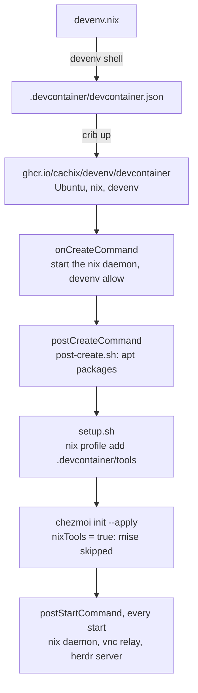

# Nix dev containers with devenv

A proof of concept: this repo's own container is built from [devenv](https://devenv.sh/) and gets my tools from Nix
instead of mise. The `default/` and `mini/` containers and every host still use mise; nothing here changes them.
On a NixOS host, [agentbox](agentbox.md) does the same job with a NixOS container instead of crib and an image.

## Nix or mise

mise stays my default for global tools; it is the simpler setup. A container with Nix is worth it when a project
needs what mise cannot give:

- **Any package on demand.** `nix shell nixpkgs#<pkg>` gives me or an agent any nixpkgs package without touching
  the container's setup.
- **Exact pins.** `flake.lock` and `devenv.lock` pin every package to a nixpkgs commit, not only a version.
- **Per-project services and native libraries** declared in `devenv.nix`: databases, compilers, system libraries.
- **One store for all containers** on a machine, through the shared `/nix` volume below.

What it costs, measured on the x1 in November 2026:

- The devenv image is 3.12 GB against 972 MB for `base:debian`; the Nix tools add about 1.9 GiB unpacked
  (671 MiB to download), shared across containers by the volume.
- nixpkgs lags behind upstream releases (node 24 where mise had 26), and there is no `minimum_release_age` delay.
- Hosts keep their mise tool list, so containers and hosts have two lists to keep in step.
- Workarounds and pitfalls that mise containers never had (see [Known issues](#known-issues)).

## How a container comes up

The container is a crib dev container like the others. Three things differ:

1. **`devenv.nix` is the source, `devcontainer.json` is generated.** `devenv shell` writes it from the
   `devcontainer.settings` block; I edit `devenv.nix`, never the JSON, and commit both.
2. **Tools come from a flake.** `setup.sh` installs `.devcontainer/tools/flake.nix` into the user's Nix profile (it
   upgrades the profile when it is already there), then runs chezmoi with `~/.nix-profile/bin` on `PATH`.
3. **chezmoi skips mise.** `.chezmoi.toml.tmpl` sets `nixTools` when it runs in a container with `nix` on `PATH`.
   Then the mise external, the mise config and the mise install script are skipped, and the scripts that run tools
   call them directly instead of through `mise exec` (`.chezmoitemplates/tool-exec`).

## Files

| File                                                | What it does                                                               |
| --------------------------------------------------- | -------------------------------------------------------------------------- |
| `devenv.nix`                                        | project packages, `enterTest`, and the container, commented                |
| `devenv.yaml`, `devenv.lock`                        | devenv's inputs and their pinned commits                                   |
| `.devcontainer/devcontainer.json`                   | generated by `devenv shell`; crib reads it                                 |
| `.devcontainer/tools/flake.nix`, `.lock`            | my global tools for Nix containers, pinned to one nixpkgs commit           |
| `.devcontainer/post-create.sh`                      | apt packages the container needs before my dotfiles                        |
| `setup.sh`                                          | installs or upgrades the tools flake, then applies my dotfiles             |
| `.chezmoi.toml.tmpl`, `.chezmoitemplates/tool-exec` | the `nixTools` switch and the mise-or-direct tool call                     |

`.chezmoiignore` keeps the devenv files out of my home directory; `.gitignore` excludes `.devenv*` and the
`devenv.local.*` overrides.

## Day to day

| I want to                                   | I run                                                                                   |
| ------------------------------------------- | --------------------------------------------------------------------------------------- |
| change the container                        | edit `devenv.nix`, `devenv shell` on the host, then `crib rebuild`                      |
| add or remove a global tool                 | edit `.devcontainer/tools/flake.nix`, then `nix profile upgrade --all` in the container |
| update all global tools                     | `nix flake update --flake ./.devcontainer/tools`, then the same upgrade                 |
| add a project package                       | `packages` in `devenv.nix`                                                              |
| update the project's nixpkgs                | `devenv update`                                                                         |
| use a tool once                             | `nix shell nixpkgs#<pkg>`, or `nix run nixpkgs#<pkg> -- <args>`                         |
| run the project's checks                    | `devenv test` (crib runs it as `updateContentCommand`)                                  |

`nix flake update` runs on any machine with Nix. A `crib rebuild` reinstalls everything from the new lock, but the
upgrade above is faster.

## Shared /nix volume

Every Nix container mounts the podman volume `devenv-nix` at `/nix`. The first container fills it from the image's
`/nix`; after that, each package downloads once per machine instead of once per container. Rules, because the
containers share it:

- **Never garbage-collect inside a container** (`nix-collect-garbage`, `nix store gc`, `devenv gc`). Each container
  sees only its own roots, so a collection deletes the other containers' tools.
- **Projects trust each other.** Root in any container can change what the others run. An untrusted project gets no
  volume, or a volume name of its own.
- **The volume hides the image's own nix and devenv.** A newer image changes nothing until the volume is recreated.

To free space or pick up a newer image: `crib down` every container that uses the volume, then
`podman volume rm devenv-nix`, then `crib rebuild` each. `rebuild`, not `up`: it also drops crib's snapshot, whose
home directory points at packages from the old volume.

I chose a volume over mounting the host's `/nix`. A host mount would expose my whole host store to agents, run
builds outside the container's limits, let the host's weekly `nix.gc` delete container tools, and work only on hosts
with Nix.

## Auto-activation

My zshrc loads `devenv hook zsh` wherever devenv is installed. A `cd` into a project trusted with `devenv allow`
starts its devenv shell in a nested shell; a `cd` out of it exits that shell. Projects that are not trusted print a
hint and stay inactive.

- In the container, `onCreateCommand` runs `devenv allow` for the workspace, since the trust list lives in the home
  folder and each new container starts without it.
- On a host, I run `devenv allow` once per project; that check keeps a cloned repo from running its devenv code on
  `cd`.
- Every shell opened in the project starts nested: `exit` once leaves the devenv shell, a second `exit` closes the
  pane.
- The devenv shell reads my `~/.zshrc` after its own environment, so on a host mise tools come before devenv's
  packages when both have the same command.
- Only interactive shells activate. An agent gets the project's packages when I start it from an activated shell.

## Another project

Not packaged yet. To try it in another project:

1. Copy `devenv.nix` and `devenv.yaml` to the project root; change `name`, the Claude mount key and
   `initializeCommand` to the project's (`claude-path` prints the mount).
2. Replace `postCreateCommand` with the inline apt install from `default/devcontainer.json`; `post-create.sh` exists
   only in this repo.
3. Copy `default/.cribrc`, run `devenv shell` to generate `.devcontainer/devcontainer.json`, then `crib up`.

`.cribrc` names my dotfiles repo without a branch, so other projects get its default branch, and the Nix tools only
once this work is merged there. After that merge, every machine needs `chezmoi init` before its next apply,
since the templates read the new `nixTools` value.

## Known issues

| Problem                                         | Cause                                                                                   | What the repo does                                                                   |
| ----------------------------------------------- | --------------------------------------------------------------------------------------- | ------------------------------------------------------------------------------------ |
| the container exits at once, no nix daemon      | crib 0.10 replaces the image's ENTRYPOINT with desktop-lite's                           | `overrideCommand`, and the daemon starts in `onCreateCommand` and `postStartCommand` |
| Chrome fails with `GLIBC_2.38 not found`        | claude-code's Nix wrapper puts its alsa-lib on `LD_LIBRARY_PATH`, which Chrome inherits | the tools flake wraps agent-browser to unset it                                      |
| my dotfiles are not applied                     | chezmoi aborts on a dangling symlink; a `result` link from `nixos-rebuild build` is one | nothing: delete any `result` link in the repo root                                   |
| `nix-shell -p` fails                            | `NIX_PATH` is empty in the image                                                        | nothing yet: use `nix shell nixpkgs#<pkg>`                                           |
| a newer image changes nothing                   | the image tag is `:latest`, and the shared volume hides the image's `/nix` anyway       | recreate the volume, see above                                                       |
