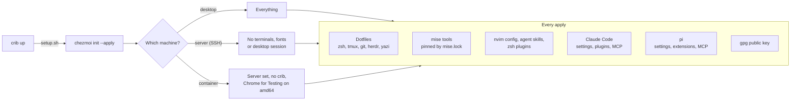

# dotfiles

My shell, editor and terminal setup, managed with [chezmoi](https://www.chezmoi.io/). One command sets up a desktop,
a server or a container without asking anything, and [mise](https://mise.jdx.dev/) installs my tools at the versions
pinned in a lockfile.



## New machine

```sh
sh -c "$(curl -fsLS get.chezmoi.io)" -- -b ~/.local/bin init --apply mgajewskik
```

- Dotfiles already there: drop `--apply`, read `chezmoi diff`, then `chezmoi apply`.
- YubiKey on this machine: install its [packages](#yubikey) first, so the first apply imports my public key.
- Desktop set up over SSH: `env -u SSH_CONNECTION chezmoi init`, or it counts as a server.
- What it detected: `chezmoi data | grep -E '"(remote|container)"'`.
- Another git identity on this machine: a `[user]` block in `~/.gitconfig.local`, which git reads last.

## Day to day

| I want to                         | I run                                         |
| --------------------------------- | --------------------------------------------- |
| edit a dotfile                    | `chezmoi edit ~/.zshrc`, then `chezmoi apply` |
| keep a change I made in place     | `chezmoi re-add ~/.zshrc`                     |
| see what apply would change       | `chezmoi diff`                                |
| commit and push                   | `chezmoi cd`, then git as usual               |
| pull and apply on another machine | `chezmoi update`                              |
| same, plus nvim, skills, plugins  | `chezmoi update -R -k`                        |

`c` is my alias for `chezmoi`. The nvim config is its own repo: I commit and push it from `~/.config/nvim`.

## Tools and plugins

- **mise**, outside a container (containers lack crib, so locking there drops it):
  - add: put it in `dot_config/mise/config.toml.tmpl`, then `chezmoi apply`
  - upgrade all: `mise lock -g --bump && mise install`
  - remove: delete it from the config, then `mise lock -g`
  - then `chezmoi add ~/.config/mise/mise.lock`
- **yazi**: after `ya pkg add` or `ya pkg upgrade`, `chezmoi re-add ~/.config/yazi/package.toml`.
- **herdr**: plugins are listed in `.chezmoiscripts/run_onchange_after_plugins_herdr.sh.tmpl`; changing its
  `refreshed:` date updates them all.
- **tmux**: `prefix I` installs, `prefix U` updates.
- **Claude Code**: plugins go in `enabledPlugins` in `.chezmoitemplates/claude/settings.json`, MCP servers in
  `.chezmoiscripts/run_onchange_after_plugins_claude.sh.tmpl`.
- **pi**: after editing an extension in place, `chezmoi re-add ~/.pi/agent`; a new one needs
  `chezmoi add ~/.pi/agent/extensions/<file>`. Settings and MCP servers go in `dot_pi/agent/modify_settings.json` and
  `modify_mcp.json`, which set their keys and keep the ones pi writes itself. crib copies `~/.pi/agent/auth.json` into
  each container; elsewhere, `/login` in pi.
- After changing `.chezmoi.toml.tmpl`, I run `chezmoi init` on each machine before the next apply, or the templates
  fail with `map has no entry for key`.

## YubiKey

```sh
sudo pacman -S --needed gnupg pcsclite ccid                         # Arch
sudo apt install gnupg scdaemon pcscd                               # Debian/Ubuntu
sudo dnf install gnupg2 pcsc-lite pcsc-lite-ccid                    # RHEL/Rocky
sudo dnf install gnupg2 gnupg2-scdaemon pcsc-lite pcsc-lite-ccid    # Fedora 43+
sudo systemctl enable --now pcscd.socket
gpg --card-status
```

## Containers

My dotfiles go into any project's container through [crib](https://github.com/fgrehm/crib), which clones this repo
and runs `setup.sh`. To start from my default container, in the project root:

```sh
mkdir -p .devcontainer && cp ~/.local/share/chezmoi/.devcontainer/default/devcontainer.json .devcontainer/
cp ~/.local/share/chezmoi/.devcontainer/default/.cribrc .
claude-path                           # creates the host folder for Claude's memory mount
echo .cribrc >> .git/info/exclude     # in someone else's repo
crib up && crib shell
```

| I want to                                  | I run                         |
| ------------------------------------------ | ----------------------------- |
| start it and get a shell                   | `crib up`, then `crib shell`  |
| apply changed mounts, env, ports, runArgs  | `crib restart`                |
| apply a changed image or features          | `crib rebuild`                |
| pause it                                   | `crib stop`                   |
| remove it (the next `up` recreates it)     | `crib down`                   |
| remove it with its images and state        | `crib remove`                 |

To test this repo, `crib up && crib shell` in the checkout runs `setup.sh` from the working tree, uncommitted changes
included. Its desktop is at http://localhost:6080 (password `vscode`). After changing `setup.sh`: `crib rebuild`.
The first time on a host, the Claude folder and gpg socket it mounts must exist:

```sh
mkdir -p ~/.claude/projects/-workspaces-chezmoi-mount && gpg-connect-agent /bye
```

### A container as a herdr machine

My host's herdr can treat each container as its own machine: panes, the nvim sidebar and agents run inside it, and
their notifications reach the host. The containers install sshd, and `~/.ssh/config.d/crib` starts it for each
connection through `podman exec`, so nothing listens on the network. It logs in with `~/.ssh/crib_ed25519`, which
`chezmoi apply` creates when it's missing; crib copies its `.pub` into each container. Once per host, I make
`Include ~/.ssh/config.d/*` the first line of `~/.ssh/config`. Further down, it would only apply to the `Host` block
above it. For each project, after `crib up`:

```sh
crib list                                             # its workspace id, e.g. myapp-1a2b3c4
herdr machine add crib-myapp-1a2b3c4 --label myapp
```

The id survives rebuilds. A container created before the key existed needs `crib rebuild`. With
`plugins.disable = ssh` in `.cribrc`, crib copies no keys, so that container can't be a machine.

When it stops working, I check from the bottom up; the first failing row is the problem:

| Layer                   | Check                                                              | If it fails                                                                                |
| ----------------------- | ------------------------------------------------------------------ | ------------------------------------------------------------------------------------------ |
| the container runs      | `crib status`                                                      | `crib up`                                                                                  |
| ssh gets in             | `ssh -o BatchMode=yes -o StrictHostKeyChecking=yes crib-<id> true` | `ssh -v crib-<id> true`; sshd's own errors: `-e` after `sshd -i` in `~/.ssh/config.d/crib` |
| herdr runs inside       | `crib run -- herdr status server`                                  | `crib run -- tail -50 /tmp/herdr-server.log`                                               |
| my host's herdr sees it | `herdr machine status myapp --json`                                | `herdr machine reconnect myapp`                                                            |
